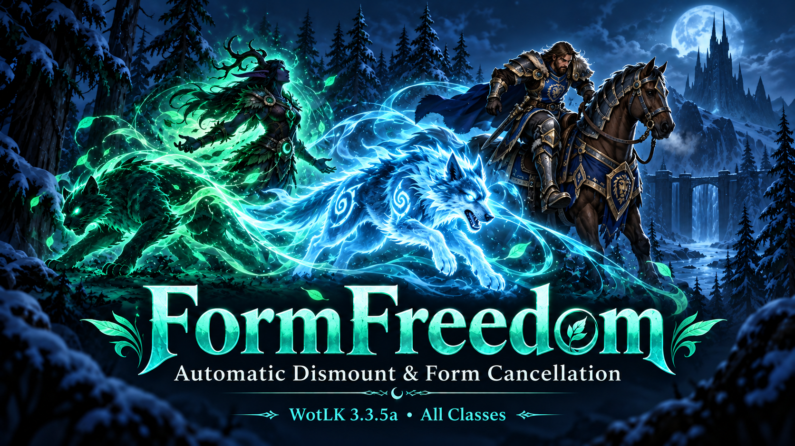

# FormFreedom

**Automatic dismounting for all classes, plus druid and shaman Ghost Wolf form cancellation, for the WotLK 3.3.5 / 3.3.5a client.**

**All classes** · **Standalone** · **ElvUI compatible**

Trying to take a flight, craft an item or use a restricted ability while mounted or shapeshifted? FormFreedom helps you leave the blocking state without writing macros or manually cancelling first.  Supported action-bar and menu helpers continue the action through your original click.  Other mounted interactions can use an error-triggered dismount fallback; click again if the original action did not continue.

Works with Blizzard's UI, ElvUI-WotLK, and [ConsolePortLK Enhanced](https://github.com/SuttonX/ConsolePortLK-Enhanced). No ElvUI file edits, settings panel or extra controls.

## What it does

| Your character | Available support |
| --- | --- |
| **Every class** | Grounded dismounting for supported actions and recognized mounted-action errors |
| **Druids** | Existing form cancellation for supported actions |
| **Shamans** | Ghost Wolf cancellation for supported actions |


| Action | How FormFreedom helps |
| --- | --- |
| **Flight masters** | Dismounts on the ground when the flight map opens; retains tested form support and secure helpers for reachable destination clicks. |
| **Crafting** | Click **Create** or **Create All**: dismount on the ground or leave form and run the normal profession-button action, preserving the selected recipe and quantity. |
| **Mounts** | Leaves a disallowed druid form or Ghost Wolf before summoning through supported paths. |
| **Fishing** | Use Fishing on a supported action bar: dismount on the ground or leave a disallowed form before casting. |
| **Restricted spells and items** | Use a known spell or resolvable item spell on a supported action bar: dismount on the ground or leave form according to its spell rules. Includes restricted teleports, profession abilities, bandages and other known item spells. |
| **Gathering and other mounted errors** | If the client reports a recognized mounted-action error while grounded and outside combat, dismounts so you can try again. |
| **Warstorm Book of Powers** | Item **9017**: mount option **2** and Dalaran option **9** dismount on the ground or leave form upon selection. Opening the book is excluded from proactive action-bar cancellation.  Client/server behavior or a mounted-error fallback can still cause earlier dismounting; on the tested Warstorm setup, the maintainer observed form/mount removal when opening the book. |

## How it works

### Blizzard's `autoUnshift` and FormFreedom

The client's built-in `autoUnshift` behavior already handles some actions. On the tested Warstorm setup, for example, the normal Hearthstone already leaves form without an addon workaround.

**FormFreedom does not enable, disable or change the `autoUnshift` setting.** It adds explicit cancellation to supported clicks that need it, using a secure `/cancelform [form]` action before continuing the original action.

### Mounted actions

Most ordinary spell casts already dismount through the client.  FormFreedom adds a secure grounded `/dismount [mounted,noflying]` fallback for supported action-bar spells/items whose stock mounted-use rules prohibit casting while mounted, and for supported crafting, flight-destination and Book of Powers clicks.  The action-bar fallback runs only while still mounted and grounded at the click.

A separate native fallback also dismounts on the ground when the flight map opens or the client emits a specific localized mounted-action error.  This can help direct gathering clicks and other paths that are not wrapped by the secure action-bar helpers.  It does not retry the failed action: click or cast again if needed.  This native fallback skips events while you are in combat, flying or on a taxi.  It does not queue a deferred dismount.  It preserves the error display and never cancels shapeshift forms in the background.

Action-bar classification leaves known spells allowed while mounted, passive spells, unknown custom actions and ambiguous item-spell matches native.  Unknown actions can still trigger the native fallback if the client explicitly reports a mounted-action error.  Tracking and mounted-combat abilities retain their mounted behavior.  Other classes keep their stances and transformations; only druids and shamans receive form cancellation.  Existing user macros are not rewritten.

Flying mounts retain native behavior.  FormFreedom does not change `autoDismountFlying`, force an airborne dismount, or attempt to interrupt taxi flights.  Private-server/client behavior can differ from the bundled stock reference.

### Spell rules, not a blanket “leave form” command

For action bars, FormFreedom uses a bundled reference of **WoW 3.3.5 spell/form restrictions**. It checks the current form against allowed/forbidden form masks, restrictions on shifted casting and mount information. It distinguishes stance-like forms from animal forms where the rules differ.

Form-changing abilities are excluded. It also avoids cancellation when leaving form cannot help an ability that requires a different form. Item spells are resolved by ID or an unambiguous localized name/rank; unknown custom spells and ambiguous matches are left unchanged.

Before redirecting a click, it checks that the bar slot still contains the classified action. It snapshots the original absolute slot so leaving form cannot accidentally select an ability from a different form page, then restores the button's ordinary state.  Missing action pages and detached buttons are skipped, and menu helpers discard stale controller redirects when their source menu is replaced.

### One hardware click

WoW protects form cancellation. FormFreedom runs it through a secure button during your click.  The separate native mounted-error fallback only dismounts; neither mechanism retries arbitrary actions in the background.

For native menus, invisible secure helpers cover only the supported buttons. They preserve the original menu's appearance and hover behavior, cancel form, then continue the selected action. No macros need to be placed on your bars.

## Compatibility

Shamans can use the same supported action-bar and menu helpers while in **Ghost Wolf**.  The bundled spell rules determine which actions require leaving the form; casting Ghost Wolf itself is not intercepted.  Other classes use the mounted-action helpers without cancelling their stances or transformations.  See [TESTING.md](TESTING.md) for validation status and test history.

- **WotLK 3.3.5a**, Interface **30300**; all classes for dismounting, druids and shamans for form cancellation. Compatibility with **3.3.5** is expected but has not been separately tested.
- **Blizzard action bars**, including the bonus/form bar and four multibars.
- **ElvUI-WotLK** action bars. ElvUI is optional; its files remain untouched.
- **ConsolePortLK**. Both CPLK controller cursor and virtual mouse cursor retain intended addon functionality.

Druid form handling has been confirmed **entirely standalone**, **alongside ElvUI 3.3.5**, and **alongside ConsolePortLK** on **Warstorm**, using the **WotLK 3.3.5a client**.  Flight-master interactions have also been confirmed to remove Ghost Wolf or dismount a mounted character, and Book of Powers Dalaran use succeeded from both states.

Other new mounted interactions, private servers, bar replacements and controller combinations are not exhaustively tested.  FormFreedom targets the original WotLK client, rather than retail WoW or modern Classic clients.  See [TESTING.md](TESTING.md) for the confirmed results, automated checks and remaining limits.

## Related addons

- [ConsolePortLK-Enhanced](https://github.com/SuttonX/ConsolePortLK-Enhanced): controller support for WotLK 3.3.5a, with improved action-bar layouts, cooldown displays, and saved layout preferences.  FormFreedom integrates with its controller cursor for supported menu actions and helps reconcile the displayed modifier bar afterward.
- [SetupSwap](https://github.com/SuttonX/SetupSwap): save account-wide desktop and controller setups, each with their own addon selections, captured settings and window positions, chat layouts, and native WoW keybindings.  Switch through a UI reload without logging out.  Keep FormFreedom enabled in both profiles to retain its supported form handling when toggling ConsolePortLK-Enhanced.

Both addons are separate, optional downloads.  [Download the latest ConsolePortLK-Enhanced.zip](https://github.com/SuttonX/ConsolePortLK-Enhanced/releases/latest/download/ConsolePortLK-Enhanced.zip) or [SetupSwap.zip](https://github.com/SuttonX/SetupSwap/releases/latest/download/SetupSwap.zip), and follow each project's installation instructions.

## Installation

[Download FormFreedom.zip](https://github.com/SuttonX/FormFreedom/releases/latest/download/FormFreedom.zip)

1. Fully close WoW.
2. Extract **FormFreedom.zip**.
3. Place the **FormFreedom** folder in `Interface/AddOns`.
4. Start WoW and enable FormFreedom in the addon list.

The ready-to-install ZIP contains one `FormFreedom` folder, including the source and documentation.  Use this attached release asset for installation; GitHub's automatic Source code archive contains a repository parent folder.

### Updating an existing installation

Fully close WoW, download the latest install ZIP, and replace the **FormFreedom** folder.  No configuration or user-created macros are required.  Keep your existing SavedVariables; FormFreedom creates none.  Any release-specific instructions belong in the [release notes](https://github.com/SuttonX/FormFreedom/releases/latest).

**Installation and updates: CLIENT RESTART; no SavedVariables reset.**

## Coverage limits

- Direct world clicks such as right-clicking ore or herbs, arbitrary quest/gossip options, and every bag/spellbook path are not guaranteed one-click handling.  The native fallback can dismount after a recognized mounted error, but you may need to click again.  Known bandage and other item spells can use the supported action-bar path; this does not guarantee every item or toy.
- Book of Powers support uses Warstorm's specific item and option indices.
- Private-server restrictions can differ from the bundled stock reference. Unknown custom actions may need dedicated support.
- Menu helpers hide securely in combat; native menu behavior remains. Action-bar classification updates wait until combat ends, while existing entries still require a matching current action.
- Existing user macros are not rewritten. Encounter transformations cannot generally be removed by ordinary `/cancelform`.

FormFreedom handles supported click paths; it does not promise to intercept every “You are in shapeshift form” or “You are mounted” error in the game.

## Found another blocked action?

If an action still displays **“You are in shapeshift form”** or **“You are mounted”** and your character does not leave the blocking state, please open an issue so we can investigate adding support. Tell us what you clicked, your form and server, and include the **item number or spell ID** if possible.

With FormFreedom enabled, type this in chat, or use it in an optional capture macro:

```text
/ffreport
```

### How to test the report capture

After installing or updating FormFreedom, **restart WoW** so its report module loads. Keep your existing SavedVariables.

1. On your druid, enter **Cat, Bear or another shapeshift form**, or enter **Ghost Wolf** on your shaman.  To investigate dismounting on any class, use a ground mount instead.
2. Type `/ffreport` in chat, or press the capture macro. You should see a message saying it is recording for **30 seconds**.
3. Within those 30 seconds, click a spell on your action bar, an item in your bag or a Book of Powers option.
4. Type `/ffreport` again, or press the macro again, to open the report immediately. Otherwise it opens when the recording timer expires.
5. Click inside the report text, press **Ctrl+A**, then **Ctrl+C**, and paste it into Notepad or your GitHub issue.

Check that the report identifies what you clicked and that copying works. **The action does not need to fail for this test.**

While recording, a captured game error should open the report after a short delay and include its text.  The report also includes mounted, flying and taxi state, plus any native dismount-fallback failure.

For Book of Powers or another item-based menu, start recording **before opening the item**, then click its option. This helps capture both the item and option index.

In your issue, tell us whether the window opened, what it recorded and whether you could copy the text. Paste the report and add a short explanation of the action and expected result.

The report can record standard action-bar, inventory, spell, crafting, gossip and taxi calls plus game error text. Some custom server actions expose no item/spell ID; describe those manually. Spell/recipe links can contain IDs even when a separate numeric ID is unavailable.

The capture is opt-in, local and limited to 30 seconds. It does not send reports, change bindings, cancel form or retry anything. This macro is only for reporting; ordinary addon use requires no macros.

## Feedback and development

Open an issue with your client/server, addon version, form, exact action and click path. Include Lua errors and item/spell IDs when available.

Addon Lua files and `FormFreedom.toc` are at the repository root. The `tests/` and `scripts/` folders contain development tools; WoW does not load them. Developers can run:

```sh
python3 scripts/check.py
python3 scripts/build_release.py
```

The mock harness requires Python 3 and Lua 5.3+ or `luatex`; addon source targets Lua 5.1. See [TESTING.md](TESTING.md), [CHANGELOG.md](CHANGELOG.md) and [CREDITS.md](CREDITS.md).

## License and credits

**Artistic License 2.0.** Upstream notices and modification provenance are preserved in [LICENSE.md](LICENSE.md) and [CREDITS.md](CREDITS.md). FormFreedom is independently named and is not an official ElvUI or ConsolePort release.
